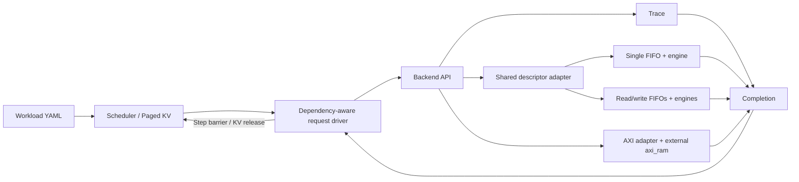
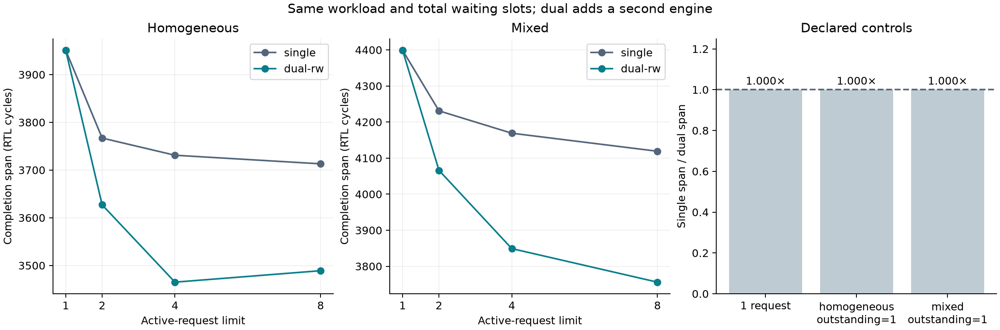

# tiny-vLLM

### A Serving-Aware Workload Frontend for RTL Evaluation

LLM 요청 길이와 Paged KV 상태에서 메모리 접근을 생성해 **외부 RTL에 공급하는 C++ 워크로드 프런트엔드**.

**Not an inference engine.** 실제 모델·GPU 없이 CPU와 Verilator로 실행한다. 실제 token 생성, attention 계산, GPU 메모리 트래픽 및 LLM 지연 예측은 범위 밖이다.



**측정 결과:** 동일한 mixed workload·동시성 8에서 single→dual span은 **4,119→3,756 cycles (1.097×)**였다. 단일 요청과 outstanding=1 대조군은 차이가 없었다. 동일 길이 workload의 이득은 동시성에 따라 단조 증가하지 않았다. 총 FIFO 대기 용량은 같지만 dual은 엔진을 추가한 구성이다. [전체 조건·해석·한계](docs/kcs-study.md).



## 시작하기

Ubuntu 24.04 또는 WSL2 Ubuntu 기준. RTL 빌드 경로는 ASCII를 사용한다.

```bash
sudo apt-get update
sudo apt-get install -y g++ cmake ninja-build libyaml-cpp-dev catch2 verilator python3 python3-venv git

cmake -S . -B "$HOME/.cache/tiny-vllm/build" -G Ninja \
  -DCMAKE_BUILD_TYPE=Release -DTINY_VLLM_ENABLE_AXI=ON -DTINY_VLLM_ENABLE_RTL=ON
cmake --build "$HOME/.cache/tiny-vllm/build" --parallel 4
ctest --test-dir "$HOME/.cache/tiny-vllm/build" --output-on-failure

"$HOME/.cache/tiny-vllm/build/tiny-vllm-axi" \
  --config examples/small.yaml --rtl-config examples/axi.yaml --output results/small
python3 tools/check_axi_run.py results/small
```

예상 출력: `Completed 4 serving steps; write=56 B, read=104 B, transactions=18`.
출력 폴더는 매번 새 경로를 지정한다. 실패 결과도 보존하며 기존 폴더를 덮어쓰지 않는다.

## 실행 대상

| 실행 파일 | 대상 | 설정 |
|---|---|---|
| `tiny-vllm-axi` | 외부 AXI RAM, 실제 저장·읽기 및 B/R 완료 | `examples/axi.yaml`, `axi-paused.yaml` |
| `tiny-vllm-rtl` | single 또는 split read/write FIFO·엔진 | `examples/rtl.yaml`, `dual.yaml`; `--rtl single\|dual-rw` |
| `tiny-vllm-trace` | 다음 가상 cycle에 완료하는 trace backend | `--rtl-config` 생략 |

Workload 예제는 `small.yaml`(단일 요청), `mixed.yaml`(동시 요청), `pressure.yaml`(KV 공간 압박)이다. Trace만 필요하면 CMake의 두 RTL 옵션을 생략한다. 테스트 없이 실행 파일만 빌드하려면 `-DBUILD_TESTING=OFF`를 지정한다.

외부 RTL은 [verilog-axi의 axi_ram](https://github.com/alexforencich/verilog-axi/blob/516bd5dadc3365b7f9e225d2af8fe0b8d804fe53/rtl/axi_ram.v)을 수정 없이 사용한다. 64-bit data/ID, 1 MiB RAM, 방향별 descriptor 하나를 지원한다. 원본·MIT 라이선스·고정 commit/hash는 `rtl/vendor/verilog-axi/`에 있다. 원 저장소는 유지보수가 종료된 상태이며 고정된 검증 대상으로 사용한다. 데이터는 실제 KV 값 대신 검증용 바이트 패턴이다.

두 아키텍처 데모는 같은 입력으로 실행한다. 각 결과의 `rtl.vcd`를 GTKWave 등에서 열 수 있다.

```bash
for rtl in single dual-rw; do
  "$HOME/.cache/tiny-vllm/build/tiny-vllm-rtl" --rtl "$rtl" \
    --config examples/architecture.yaml --rtl-config examples/dual.yaml --output "results/demo-$rtl"
  python3 tools/check_rtl_run.py "results/demo-$rtl"
done
```

각 실행은 write=5,376 B, read=22,400 B, 584 transactions를 완료한다. 예제 설정의 총 FIFO 대기 용량은 8, descriptor 처리 시간은 7 cycles다.

## 구조

```text
src/                 코어, 설정, 공통 CLI, RTL adapters
include/tiny_vllm/    C++ 인터페이스
rtl/                 예제 RTL과 고정 외부 RTL
examples/            workload와 backend 설정
tests/               코어·RTL·CLI 검사
tools/               wire 검사, AXI 검증, 전체 재현, 소스 패키징
  experiments/       실험·분석·그림
  reference/         선택적 vLLM scheduler 비교
docs/                설계 계약과 검증·재현 방법
```

`build/`, `results/`, `dist/`는 로컬 생성물이며 Git에 포함하지 않는다.

## 결과와 문서

`summary.csv`는 완료 bytes·점유량·최종 상태, `events.csv`는 요청·KV 수명, `transactions.csv`는 요청별 생성·수락·완료를 기록한다. AXI 실행은 `axi_cycles.csv`와 `axi_summary.csv`도 생성한다. 오류 사유와 실행 조건은 `metadata.yaml`에 남는다.

- [설계와 RTL 연결 계약](docs/design.md)
- [검증 결과·전체 재현·vLLM 비교](docs/validation.md)
- [아키텍처 비교 연구·전체 수치·파형](docs/kcs-study.md)

독립 주소 기준, AXI wire/readback, backpressure, 완료 의존성, 자원 회수 및 오류 검출을 검사한다. vLLM과의 제한된 비교는 **7조건 일치·2조건 chunk 정책 차이**이며 전체 호환성을 주장하지 않는다.
