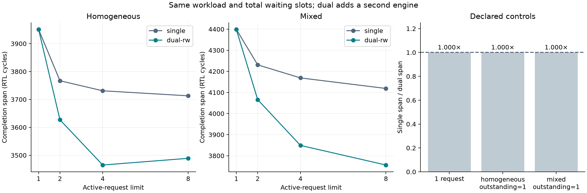
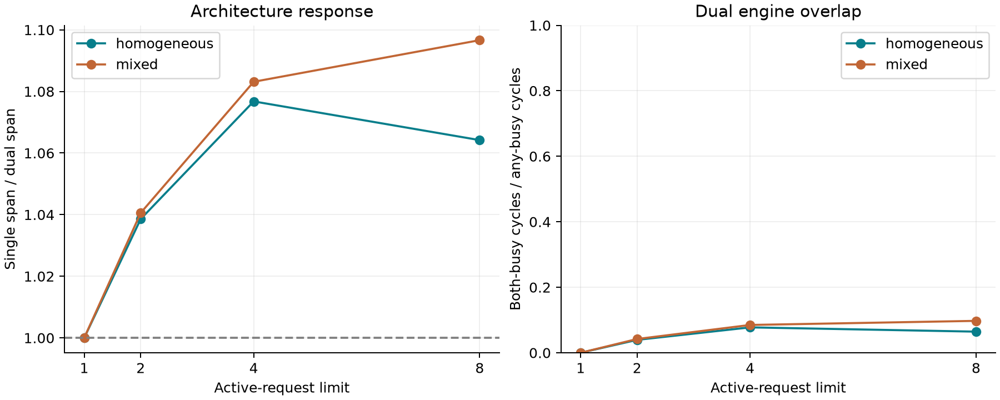
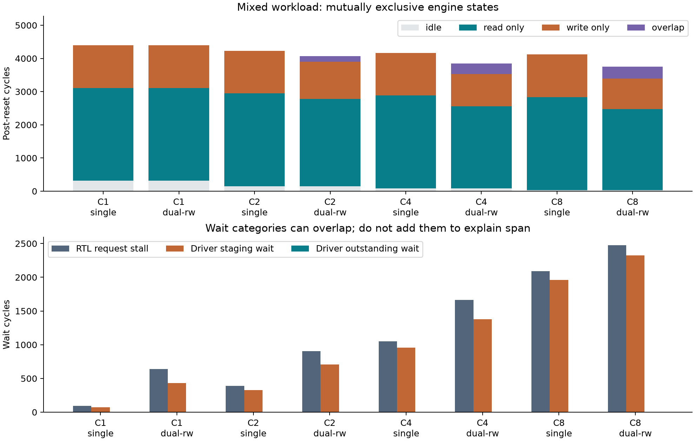
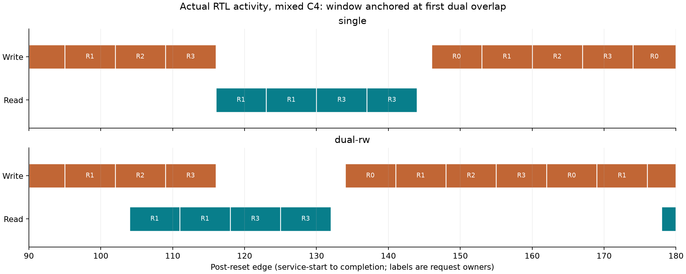

# Case study: serving concurrency and split read/write RTL

**When does serving concurrency expose read/write overlap to independent RTL engines?**

The frontend, KV policy, address generator, and Backend API stay fixed while the reference RTL organization changes. The external AXI RAM remains a separate integration/readback check. This is an example of using the frontend, not an inference-speed or equal-area optimization claim.

## Observations

1. Single-request execution exposes no read/write overlap under the declared dependency policy.
2. Concurrent requests can expose inter-request independence that split engines exploit.
3. Serving concurrency alone does not guarantee more overlap.

Restricting the frontend to one outstanding memory request removes the benefit in both declared C4 controls. This supports the role of overlapping work in these cases; it does not establish a general performance theorem.

## Declared experiment

[`build_architecture_plan()`](../tools/study/plan.py) declares all inputs, predictions, and independent byte totals before execution. The runner records the complete plan, time, and source/binary hashes before starting workloads. Failed cases remain in the record and prevent success-only aggregation. The workload/service parameters were not selected after observing the results.

| Parameter | Fixed setting |
|---|---|
| Single-engine | Shared FIFO capacity 8, one engine |
| Split read/write | Read FIFO 4 + write FIFO 4, two engines |
| Shared ports | One input and one completion per cycle; one adapter staging slot |
| Service cost | 7 cycles per descriptor in either direction, independent of bytes |
| Driver | Outstanding limit 16; control limit 1 |
| Geometry | L=1, H=1, D=8, S=2: 32 K+V bytes/token |
| KV pool | 64 blocks × 4 tokens = 8,192 B |
| Scheduler | Token budget 32, prefill chunk 4, active limit 1/2/4/8 |
| Transactions | At most 64 B, retaining block/layout splits |
| Arrivals | All requests arrive at logical step 0 |

Total **runtime waiting capacity** is matched, not physical storage or area. Split adds an active engine and partitions the queue; the experiment does not isolate these two changes. Every request can be reserved simultaneously in the pool, removing capacity-driven admission pressure.

- Single-request: one `(P,O)=(8,8)` request, active=1.
- Homogeneous: eight `(8,8)` requests, active=1/2/4/8.
- Mixed: four repetitions of `(24,2),(2,16)`, active=1/2/4/8.
- Serial-driver controls: homogeneous/mixed active=4 with outstanding=1.

There are 11 pairs: 11 trace and 22 RTL executions. These are deterministic synthetic conditions, not independent statistical samples. The prediction allows overlap with multiple requests, but does not predict monotonic improvement.

## All results

Span is last completion edge minus first RTL request handshake edge. The ratio is single span / split span. Overlap is both-busy / any-busy cycles. Busy includes waiting for completion transfer; completion-arbitration wait happened to be zero in every normal study run.

| Workload | Active | Outstanding | Single span | Split span | Ratio | Split overlap |
|---|---:|---:|---:|---:|---:|---:|
| Single-request | 1 | 16 | 493 | 493 | 1.000× | 0.00% |
| Homogeneous | 1 | 16 | 3,951 | 3,951 | 1.000× | 0.00% |
| Homogeneous | 2 | 16 | 3,767 | 3,627 | 1.039× | 3.94% |
| Homogeneous | 4 | 16 | 3,731 | 3,465 | 1.077× | 7.76% |
| Homogeneous | 8 | 16 | 3,713 | 3,489 | 1.064× | 6.45% |
| Mixed | 1 | 16 | 4,399 | 4,399 | 1.000× | 0.00% |
| Mixed | 2 | 16 | 4,231 | 4,066 | 1.041× | 4.21% |
| Mixed | 4 | 16 | 4,169 | 3,849 | 1.083× | 8.49% |
| Mixed | 8 | 16 | 4,119 | 3,756 | 1.097× | 9.74% |
| Homogeneous control | 4 | 1 | 4,751 | 4,751 | 1.000× | 0.00% |
| Mixed control | 4 | 1 | 5,255 | 5,255 | 1.000× | 0.00% |



Exact values: [comparisons](results/architecture-comparisons.csv) and [all metrics](results/architecture-metrics.csv). Frozen CSV/config/figure labels use `dual-rw`, the historical name for split read/write. CLI `--rtl split-rw` selects the same target. No numerical results changed in the onboarding reorganization.

Single-request W/R=480/2,688 B with 66 transactions; homogeneous=3,840/21,504 B with 528; mixed=5,376/22,400 B with 584. Transaction counts happen to remain unchanged across concurrency in this study; other batching/splitting configurations may differ.

## Interpretation and limits

A single request waits for its own writes before reading. Multiple requests allow one request's read to overlap another's write. The wire checker reconstructs engine activity from starts/completions and verifies that overlapping transactions have different serving-request owners.



Mixed C8 overlaps 363 cycles and reduces span by 363 cycles, or **8.81%**. That is the same observation as a **1.097× span ratio**, not a GPU throughput result.

Homogeneous C4→C8 reduces overlap from 266 to 224 cycles. Idle decreases from 36 to 18, but split span rises by 24 cycles (3,465→3,489). Total engine work stays at 528×7=3,696 cycles; `all edges = idle + engine work − overlap` accounts for the difference. Input order, staging, and partitioned queues can constrain overlap; their individual effects were not separated by ablation.



More input stalls need not mean a longer span. Mixed C8 has 2,092 single-engine request-stall cycles versus 2,474 split cycles. Each split direction has fewer waiting slots, changing where work waits. Driver outstanding-limit wait is zero here. Wait categories can overlap and cannot be added to reconstruct span.

These results cover a small declared length set, a fixed descriptor cost, and the `prefill_store_decode_scan` policy. Decode scans and global step barriers limit overlap. Numeric compute, prefill attention reads, DRAM banks/timing, area, power, and wall-clock arrival rates are absent. Completion feedback controls progress; it does not make scheduling adaptive. A different testbench implementing the same dependencies could reproduce the effect.

## Real activity and reproduction



The activity figure uses actual service-start/completion records from mixed C4. Its window is chosen mechanically: first split overlap edge −15 through +75. Both panels use the same absolute edge axis. Labels are serving-request owners; headline metrics cover the entire run. `mixed-c4/{single,dual-rw}/rtl.vcd` retains the actual internal signals.

The full [reproduction command](validation.md#reproduce-everything) includes the study. To run only the study:

```bash
"$HOME/.cache/tiny-vllm/plot-env/bin/python" tools/study/architecture.py \
  --trace "$HOME/.cache/tiny-vllm/release/tiny-vllm-trace" \
  --rtl "$HOME/.cache/tiny-vllm/release/tiny-vllm-rtl" --output results/architecture
```

Re-audit saved results with `--input results/architecture --output results/architecture-reaudit` instead of binary arguments. Every output path must be new. Raw runs stay in `results/`; published CSVs and figures are copied directly from audited study output. The original artifact is retained at `kcs2027-freeze`.
