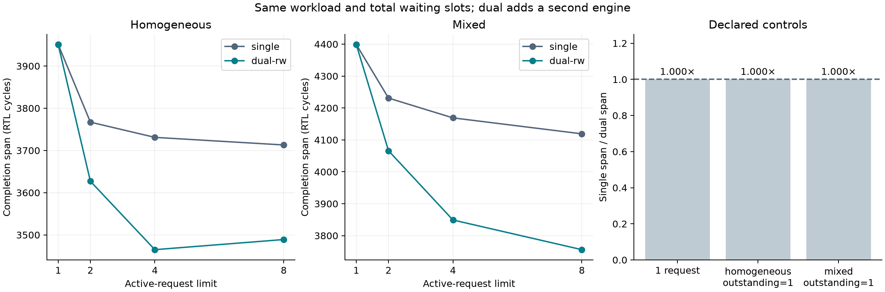
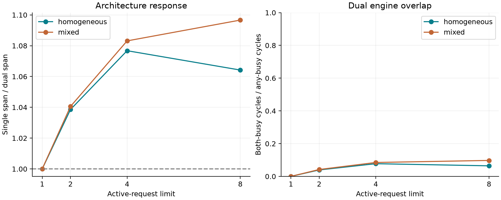
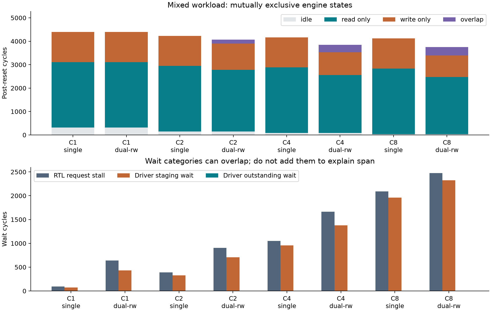
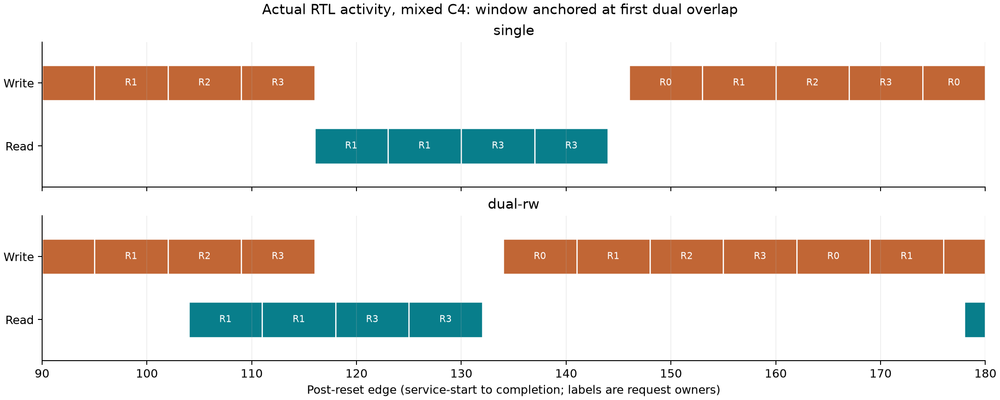

# Serving 동시성과 split read/write RTL

## 질문과 측정 대상

**같은 serving workload에서 active-request 상한이 달라지면, read/write 엔진 분리의 효과도 달라지는가?** Scheduler·KV 관리·주소 생성·Backend API를 유지하고 synthetic RTL 구성만 바꾼다. 기존 외부 AXI RAM은 별도 연결·readback 검증 대상으로 유지한다.

이 실험의 기여는 명시된 serving 의존성과 RTL 실행을 연결한 측정 사례다. 실제 inference 가속, 새 최적 scheduling 알고리즘, 동일 면적 하드웨어 개선, trace 도구 대비 우위를 주장하지 않는다. 같은 의존성을 구현한 다른 testbench에서도 재현할 수 있다.

## 실행 전에 고정한 조건

[`build_architecture_plan()`](../tools/experiments/plan.py)에 모든 조건과 예상을 정의한다. 실행기는 첫 subprocess 전에 plan·시각·소스/실행 파일 SHA256을 저장한다. 실패 조건도 보존하며, 하나라도 실패하면 성공한 조건만 모아 그림을 만들지 않는다. 결과를 본 후 workload나 service 지연을 고르지 않았다.

| 항목 | 고정 조건 |
|---|---|
| Single | 공용 FIFO 8 + engine 1 |
| Dual | read FIFO 4 + write FIFO 4 + engine 2 |
| 공통 포트 | 입력 1개/cycle, 완료 1개/cycle, staging 1칸 |
| Service | read/write 모두 descriptor당 7 cycles; byte 수와 독립 |
| Driver | outstanding 16; 추가 대조군 1 |
| Geometry | L=1, H=1, D=8, S=2 → token당 K+V 32 B |
| KV | block 4 tokens, pool 64 blocks = 8,192 B |
| Scheduler | token budget 32, prefill chunk 4, active 상한 1/2/4/8 |
| Transaction | 최대 64 B, 기존 block 경계 분할 유지 |
| 도착 | 모든 요청 arrival_step=0 |

총 **runtime 대기 용량**을 맞췄다. Dual은 active engine과 물리 배열이 더 많으며, 큐 분할·엔진 추가를 함께 바꾼 아키텍처 비교다. 결과를 엔진 추가만의 독립 효과로 분리하거나 면적 효율로 해석하지 않는다. 풀은 모든 요청을 함께 예약할 수 있어 admission의 용량 압박을 제거한다.

- Single-request: `(P,O)=(8,8)` 하나, active=1.
- Homogeneous: `(8,8)` 8개, active=1/2/4/8.
- Mixed: `(24,2),(2,16)`를 4회 반복한 8개, active=1/2/4/8.
- Serial-driver 대조군: homogeneous/mixed active=4, outstanding=1.

총 11쌍, trace 11회 + single/dual 22회다. 결정론적 synthetic 조건이므로 반복 횟수를 통계 표본으로 세거나 오차 막대를 만들지 않는다. 예측은 “단일 요청과 serial-driver에서는 중첩 없음, 여러 요청은 중첩 가능”이며, 동시성에 따른 단조 개선은 예측하지 않았다.

## 전체 결과

Span은 마지막 completion edge − 첫 request edge다. 비율은 single span / dual span으로, 1보다 크면 이 조건에서 dual이 짧다. 중첩은 두 엔진 모두 busy인 cycle / 하나 이상 busy인 cycle이다. Busy에는 완료 포트 대기가 포함된다. 이번 정상 study에서는 완료 arbitration 대기가 양 방향 모두 0이었다.

| Workload | Active | Outstanding | Single span | Dual span | 비율 | Dual 중첩 |
|---|---:|---:|---:|---:|---:|---:|
| Single-request | 1 | 16 | 493 | 493 | 1.000× | 0.00% |
| Homogeneous | 1 | 16 | 3,951 | 3,951 | 1.000× | 0.00% |
| Homogeneous | 2 | 16 | 3,767 | 3,627 | 1.039× | 3.94% |
| Homogeneous | 4 | 16 | 3,731 | 3,465 | 1.077× | 7.76% |
| Homogeneous | 8 | 16 | 3,713 | 3,489 | 1.064× | 6.45% |
| Mixed | 1 | 16 | 4,399 | 4,399 | 1.000× | 0.00% |
| Mixed | 2 | 16 | 4,231 | 4,066 | 1.041× | 4.21% |
| Mixed | 4 | 16 | 4,169 | 3,849 | 1.083× | 8.49% |
| Mixed | 8 | 16 | 4,119 | 3,756 | 1.097× | 9.74% |
| Homogeneous control | 4 | 1 | 4,751 | 4,751 | 1.000× | 0.00% |
| Mixed control | 4 | 1 | 5,255 | 5,255 | 1.000× | 0.00% |



정확한 수치는 [비교표](results/architecture-comparisons.csv), [방향별 transaction·queue·utilization·stall을 포함한 전체 지표](results/architecture-metrics.csv)에 있다. Single-request는 W/R=480/2,688 B·66 transactions, homogeneous는 3,840/21,504 B·528, mixed는 5,376/22,400 B·584다. 각 workload 내에서는 동시성을 바꿔도 이번 transaction 수가 같았다. 일반적으로는 batching/분할에 따라 달라질 수 있어 매번 검사한다.

## 해석과 한계

단일 요청은 자기 write 완료 후 read를 시작한다. 다른 요청이 없으면 두 방향을 겹칠 기회가 없어 dual도 같은 span이다. 여러 요청에서는 한 요청의 write와 다른 요청의 read가 겹친다. 별도 checker가 start/completion 이력으로 busy를 재구성하고, 중첩된 두 transaction의 요청 소유자가 다른지 확인한다. Outstanding=1로 이를 막으면 다중 요청이어도 span 이득이 사라졌다.



Mixed C8은 363 cycles를 겹쳐 처리하며 span이 363 cycles, 약 **8.81%** 감소했다. 이것은 **1.097× span 비율**과 같은 관측을 다른 방식으로 표현한 것이다. GPU throughput 개선 수치가 아니다.

Homogeneous에서는 C4→C8 시 dual 중첩이 266→224 cycles로 줄었다. Idle은 36→18로 줄었지만 span은 3,465→3,489로 오히려 24 cycles 늘었다. 두 조건의 총 engine 작업량은 528×7=3,696 cycles로 같고, `전체 edges = idle + engine 작업량 − overlap` 관계가 이 차이를 설명한다. 입력 순서·staging·분할 FIFO가 중첩 기회를 제한할 수 있으나 각각의 기여를 분리하는 ablation은 하지 않았다.



Dual의 request stall은 더 많아질 수 있다. Mixed C8은 single 2,092, dual 2,474 cycles다. 각 방향에 4칸만 배정한 결과 대기 위치와 입력 수락 시각이 달라지며, 높은 stall 수 자체가 긴 전체 span을 뜻하지 않는다. 이 조건의 driver outstanding-limit wait는 0이다. 세 wait 지표는 겹칠 수 있으므로 합산해 span을 설명하지 않는다.

이 결과는 소수의 정해진 길이 workload·고정 service 비용·동일 prefill/decode 정책에 대한 것이다. 긴 context에서 read가 많고 global step barrier가 있으므로 중첩 비중은 작다. 실제 token 계산·prefill attention read·DRAM bank/timing·면적·전력·실시간 도착률은 모델링하지 않았다. Frontend가 completion을 기다리는 것은 검증했지만 backend 지연에 따라 admission 정책 자체가 바뀌는 adaptive scheduling은 구현하지 않았다.

## 실제 파형과 재현



그림은 mixed C4의 실제 `rtl_cycles.csv`에서 service start→completion 구간을 그렸다. 창은 **dual에서 첫 overlap이 관측된 edge −15부터 +75까지**로 자동 선택한다. 동일한 절대 edge 축이며 색은 방향, 글자는 요청 ID다. 본문 지표는 창 밖을 포함한 전체 실행 기준이다. `mixed-c4/{single,dual-rw}/rtl.vcd`에는 reset·FIFO·ready/valid·엔진 내부 신호가 있다.

전체는 [`tools/reproduce.py`](validation.md#전체-재현)에 포함된다. 연구만 실행하려면 빌드 후:

```bash
"$HOME/.cache/tiny-vllm/plot-env/bin/python" tools/experiments/architecture.py \
  --trace "$HOME/.cache/tiny-vllm/build/tiny-vllm-trace" \
  --rtl "$HOME/.cache/tiny-vllm/build/tiny-vllm-rtl" --output results/architecture
```

이미 저장한 결과만 재검사하려면 `--trace/--rtl` 대신 `--input results/architecture --output results/architecture-reaudit`를 쓴다. 새 output에 CSV와 PNG/SVG를 만든다. 원시 자료는 `results/`에 남기고, Git에는 위 표·그림과 재현 소스를 둔다. 공개 표는 동일 plan에서 생성한 CSV를 그대로 복사한 것이다.
