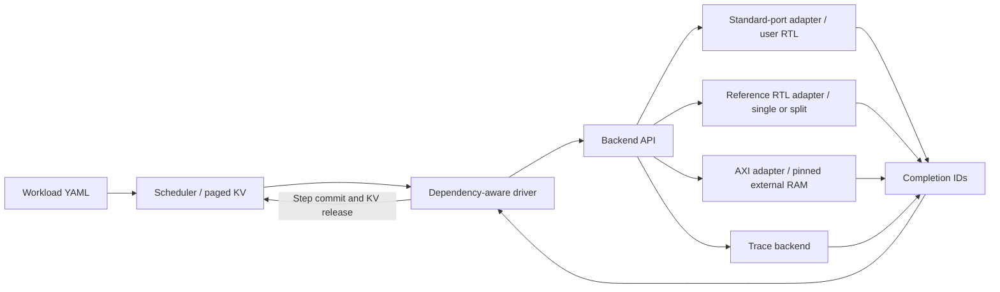

# Overview

tiny-vLLM is a lightweight, serving-aware workload frontend for early-stage LLM accelerator RTL evaluation.

It is for a student or RTL designer who has a memory-facing block and wants requests that carry serving dependencies and KV lifetime, without implementing an inference stack. A descriptor interface cannot drive an arbitrary compute datapath without a wrapper that maps memory operations to that datapath's protocol.

## What the frontend supplies

Input lengths and logical arrivals determine serving work. The scheduler admits requests, reserves KV space, and schedules prefill/decode chunks. The driver generates physical byte ranges from paged KV mappings. It preserves requests through rejection, tracks outstanding IDs, and waits for real completion before dependent phases and block release.

The standard wrapper is the user integration route. Reference RTL provides visible queues and engines for learning and regression. The [single/split study](case-study.md) is one use of the frontend, not its definition.

## What feedback means here

Backend delay can postpone memory submissions, dependent accesses, step commits, and KV release in backend cycles. Arrivals are expressed in logical serving steps. The current scheduler does not use measured backend latency to change its policy. On the declared experiments, trace and RTL retain the same logical work and scheduling totals.

There is no numeric attention, token sampling, GPU execution, calibrated DRAM model, or full-vLLM compatibility claim. Other tools can implement the same dependencies; this project does not claim that completion feedback is unique.

## Glossary

| Term | Meaning |
|---|---|
| Frontend | Serving scheduler, KV state, dependency tracking, and memory request generation |
| Backend | C++ abstraction that owns and executes accepted memory requests |
| RTL target | The actual simulated DUT behind an adapter |
| Reference RTL | Bundled single-engine and split read/write descriptor services |
| External RTL | A separately developed DUT, including the vendored AXI RAM |
| Serving request | One prompt/output-length request, identified by a string such as `A` |
| Active request / serving concurrency | A serving request admitted by the scheduler / number of such requests |
| Memory request / transaction | One byte-range operation with a numeric completion ID |
| Outstanding memory requests | Accepted by the backend but not yet completed; includes adapter staging |
| Backpressure | Temporary refusal at the backend API or at the RTL ready/valid interface |
| Completion | A previously accepted memory operation has finished; its ID can be retired |
| KV block | Fixed token-count allocation unit; physical bundles include all modeled layers/heads |
| Completion span | Last completion edge minus first RTL request handshake edge; not frontend acceptance time |

## Repository map

`src/core.cpp` and `src/config.cpp` implement the frontend. `include/tiny_vllm/backend.hpp` is the small public C++ contract. `src/backends/` contains adapters. `rtl/reference/`, `rtl/template/`, and `rtl/vendor/` separate examples, integration, and third-party sources. `tools/study/` contains research reproduction, while `tools/check_*_run.py` checks persisted wire records.

Next: [workload model](workload-model.md) or [bring your own RTL](bring-your-own-rtl.md).
